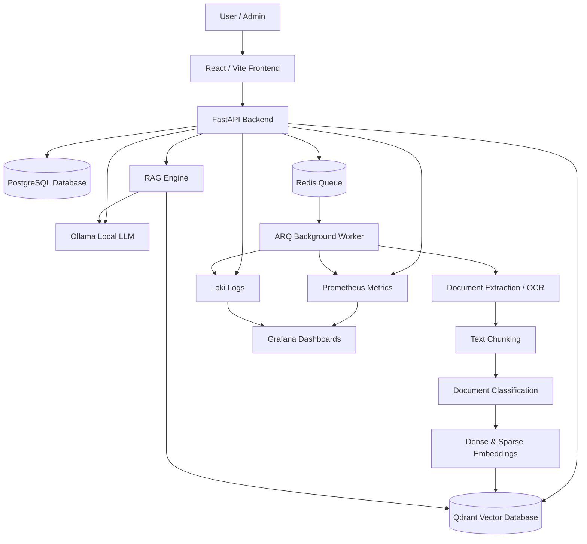

# Intelligent Document Management & Retrieval System (IDMS)

## Project Status

This project was developed as a capstone prototype. Core features such as authentication, document upload, OCR processing, hybrid retrieval, RAG-based question answering, admin monitoring, audit logging, and observability are implemented.

## Executive Overview

The **Intelligent Document Management & Retrieval System (IDMS)** is a locally deployable end‑to‑end platform for storing, processing and retrieving heterogeneous documents. IDMS ingests PDF, Word, PowerPoint, Excel, CSV and image files, extracts text using OCR where required, slices it into meaningful chunks, generates dense **bge‑m3** and learned‑sparse embeddings, and stores the vectors in **Qdrant** alongside metadata. A hybrid retriever fuses dense and sparse scores with Reciprocal Rank Fusion (RRF) and a cross‑encoder reranker to surface relevant chunks. A Retrieval‑Augmented Generation (RAG) engine then answers free‑form questions by selecting evidence, verifying sufficiency and generating concise answers via a local **Ollama** model (defaults to *phi3.5*). All responses are citation backed – IDMS always returns the source document titles and page ranges used to generate the answer.

Originally developed as a capstone project, IDMS emphasises privacy and local operation. It runs entirely on your hardware: no external AI APIs are required. The default Docker stack launches **FastAPI** backend services, **React/Vite** frontend, **Qdrant** vector database, **PostgreSQL** relational database, **Redis** task queue, **ARQ** background worker, and an observability suite (Prometheus, Grafana, Loki and Promtail). With a locally running **Ollama** server and phi3.5 model pulled in advance, IDMS provides a complete document‑management and question‑answering system on standard developer hardware.

IDMS distinguishes itself from simple file storage systems by combining OCR extraction, classification, chunking, hybrid search and RAG in a single pipeline. It supports role‑based access control, user history, audit logging and real‑time progress updates for ingestion jobs. Admins can monitor system health and view logs via built‑in dashboards. The system is designed for extensibility—additional extraction modules, embedding models or LLMs can be swapped in without changing the high‑level workflow.

## Table of Contents

1.  [System Objectives](#system-objectives)
2.  [Key Features](#key-features)
3.  [System Architecture](#system-architecture)
4.  [Technology Stack](#technology-stack)
5.  [Repository Structure](#repository-structure)
6.  [Backend Overview](#backend-overview)
7.  [Frontend Overview](#frontend-overview)
8.  [Database Design](#database-design)
9.  [Document Processing Pipeline](#document-processing-pipeline)
10. [Search and Question Answering](#search-and-question-answering)
11. [Authentication and Authorization](#authentication-and-authorization)
12. [Admin Functionality](#admin-functionality)
13. [API Overview](#api-overview)
14. [Project Screenshots and Visual Documentation](#project-screenshots-and-visual-documentation)
15. [Installation Guide](#installation-guide)
16. [Usage Guide](#usage-guide)
17. [Configuration](#configuration)
18. [Testing](#testing)
19. [Security Considerations](#security-considerations)
20. [Deployment Notes](#deployment-notes)
21. [Troubleshooting](#troubleshooting)
22. [Future Work](#future-work)
23. [Development Team](#development-team)
24. [Conclusion](#conclusion)

## System Objectives

IDMS aims to provide a privacy‑preserving, locally run platform for managing and retrieving documents with citation‑backed question answering. Its main goals include:

- **Upload and manage documents:** Accept heterogeneous file formats (PDF, DOCX, PPTX, XLSX, CSV, JPEG, PNG, TIFF, WEBP) up to 50 MB. Users can list, preview, download or delete their documents.
- **Extract and process content:** Perform OCR and document conversion for images and scanned PDFs. Use **Docling** for PDF, Office and image extraction; special handling for CSV that yields summary chunks and row‑level blocks.
- **Chunk and classify:** Slice extracted text into context‑aware chunks via a sliding window; classify the whole document into categories (Legal, Financial, HR, Operations, Sales, IT) using a linear SVM over **bge‑m3** embeddings. Classification is optional when the user has already assigned a category.
- **Index and search:** Generate dense and sparse embeddings per chunk, then upsert them into Qdrant with metadata. Support lexical filtering (by user and category) and hybrid retrieval fused with RRF. Use a cross‑encoder reranker to refine candidate order.
- **Answer questions:** Retrieve top evidence for a user’s question, check sufficiency, and call a local LLM (Ollama phi3.5) to generate a concise answer. Use a hypothetical HyDE query if the initial search yields insufficient evidence.
- **Manage users and roles:** Support registration, login, JWT issuance/refresh and temporary viewer sessions. Roles (Admin, Manager, User) control access to admin endpoints. Soft deletion and active status flags protect user accounts.
- **Monitor and audit:** Record structured audit logs for key actions (document uploads, logins, category updates, deletions, etc.), export metrics to Prometheus, and expose dashboards in Grafana. Provide admin APIs for viewing logs and question/answer history.
- **Observability and evaluation:** Include an observability stack (Prometheus, Grafana, Loki, Promtail) and an evaluation harness using a micro‑corpus to measure citation accuracy, OCR quality and retrieval latency.

## Key Features

### User Authentication & Authorization

- **Registration & Login:** Users register with email, password, first/last name and optional phone number. Passwords are hashed with bcrypt. On login, tokens contain user ID, role string and a short expiry. Successful and failed logins are recorded in the audit log.
- **JWT & Session Management:** Access tokens include a *session version*. When users reset their password or log out, the session version increments to invalidate old tokens. Refresh tokens can extend sessions without re‑entering credentials.
- **Viewer Sessions:** Anonymous users can obtain a short‑lived “viewer” token that allows up to 10 document uploads and 20 question attempts. Viewer accounts are deleted automatically after expiration.
- **Role‑based Permissions:** Roles (Admin, Manager, User) map to numeric IDs (1–3) and determine access. Admin routes require admin privileges; managers can view but not change some resources; normal users can only see their own documents. Permissions are enforced in dependencies and at the SQL level using role_id foreign keys.
- **Password Reset:** Users can request a password reset email. Reset tokens are stored in `password_reset_token` table with expiration and used by the frontend to create a new password.

### Document Management

- **Upload API:** `POST /api/documents/upload` accepts a multipart file and optional category. The system validates file type and size, generates unique document and job IDs, stores the raw file in local file storage and enqueues a background job. Users with *viewer* role are limited to 10 files. Unsupported formats or size violations return HTTP 422.
- **Listing & Preview:** `GET /api/documents` returns metadata (filename, category, status, size, created time). `GET /api/documents/{id}/extraction-preview` returns the first three extracted pages for OCR preview. `GET /api/documents/{id}` returns detailed metadata including classification, processing status and deletion flag.
- **Category Update & Delete:** Users can update a document’s category via `PATCH /api/documents/{id}/category`. Deletion (`DELETE /api/documents/{id}`) removes database rows, file storage and Qdrant vectors; operations are idempotent and respect ownership. Deletions and category updates are recorded in the audit log.
- **Download:** The system exposes a secure viewer endpoint allowing authorized users to download the original file; temporary signed URLs prevent cross‑user access.

### Background Ingestion Pipeline

- **ARQ Worker:** Runs as a separate process (`arq app.worker.WorkerSettings`) and processes queued documents. For each document it:

  - Marks job stage as *extracting* and reads file bytes.

  - Uses **Docling** extractors (PDF/image/Office) or a custom CSV extractor to produce page texts; pages are stored in the `page` table.

  - Splits pages into overlapping chunks with metadata (document ID, page range, chunk index) and stores them in the `chunk` table. For CSVs, row blocks and summary are treated as separate chunks. Each chunk’s provenance is enforced by verifying non‑null `page_start` and `page_end` values.

  - Classifies the document by embedding all chunks and using a linear SVM. If ambiguous, leaves the category null; otherwise updates the `document` row.

  - Calls **indexer** to generate dense and sparse embeddings (BAAI bge‑m3) and upsert them into Qdrant. After successful insertion it marks `chunk.qdrant_indexed = True` and transitions job stage to *indexing_complete*.

  - Marks the document status as *indexed* and the job as *completed*. Errors (e.g. OCR out‑of‑memory) are caught and recorded; the system gracefully reports failures and allows re‑upload.

- **Prometheus Metrics:** The worker exposes metrics such as ingestion duration, job count, OCR failures, memory usage and classification time. These metrics feed Grafana dashboards.

### Search

- **Hybrid Retriever:** The searcher uses dense and learned‑sparse query embeddings from bge‑m3 to prefetch a candidate pool from Qdrant. It performs server‑side reciprocal rank fusion (RRF) and then runs a cross‑encoder (bge‑reranker‑v2‑m3) on the candidate pool to rerank results. The searcher supports filtering by category, user ID or explicit document ID allow‑lists. It returns scored points with a payload indicating whether scores came from the reranker or RRF fallback, enabling downstream confidence calibration.
- **API:** `GET /api/search` accepts query string, `top_k`, optional category filter and returns relevant chunks with scores and metadata. For multi‑page results, the frontend highlights matched text and displays citations.

### Question Answering (Q&A)

- **RAG Engine:** The `RagEngine` orchestrates retrieval, evidence sufficiency checks, HyDE fallback and LLM invocation. For each question:

  - Retrieve up to 8 top chunks using the hybrid retriever (dense + sparse + RRF + reranker).

  - If the top score is below a threshold (configurable `rag_min_evidence_score`), compute a *HyDE* hypothetical query: a short, retrieval‑oriented rephrasing of the question. Rerun retrieval with the HyDE query; if this still yields low scores, the engine refuses to answer.

  - Truncate each selected chunk to `PROMPT_MAX_CHUNK_CHARS` characters, assemble them into a context block and add a system prompt instructing the model to answer concisely based only on the provided evidence. The engine sets Ollama options such as `num_predict` and `temperature` to produce deterministic answers.

  - Call the local Ollama `phi3.5` model via HTTP with the context. For streaming Q&A, the endpoint uses Server‑Sent Events (SSE) to return tokens as they are generated.

  - Map back chunk IDs to human‑readable citations: document titles, page ranges and categories. The frontend displays citations alongside the answer and allows users to open the source documents.

- **Refusal & Confidence Handling:** If evidence is insufficient or the model returns a refusal string, the engine responds with `I cannot answer this question based on the available documents.` Confidence levels (high, medium, low) are computed from reranker scores and question–evidence overlap; these are returned to the frontend for UI badges.

### User History & Feedback

- **Question History:** Every question and answer is stored in the `qa_history` table with user ID, question text, answer text, response time and cited document IDs. Admins can view history and redacted history; managers can view aggregated metrics per user or category.
- **Feedback:** Users can submit feedback on the system via `POST /api/feedback`, stored in the `feedback` table. This can be used to improve the system iteratively.

### Admin & Observability

- **Logs:** Admins can fetch audit logs via `GET /api/admin/logs`. Logs contain action, resource type, status, severity, user ID, IP address and metadata. Audit entries are append‑only and cannot be deleted or updated.
- **Question History:** Admins have endpoints to list question history of all users, filter by date ranges or categories and view redacted responses (provenance only).
- **Observability:** Prometheus scrapes metrics from the FastAPI and worker services; Grafana dashboards show ingestion performance, GPU/CPU utilisation, memory usage and latency distributions. Loki collects logs and Promtail tails container logs for structured search. The default Docker stack exposes Grafana at `http://localhost:3000`.

### Frontend Features

- **Responsive React/Vite UI:** Provides pages for login, registration, dashboard, management (upload and document list), search, knowledge base, Q&A chat, profile, admin dashboards and announcements. Routing is handled by React Router and conditional rendering ensures only authorised pages are accessible. Streaming Q&A updates appear in real time.
- **Progress Indicators:** When uploading a document, the management page shows the ingestion pipeline stages: extracting, chunking, classifying and indexing. Progress bars update via polling of job status and show success or failure messages.
- **Search & Knowledge Base:** Users can search across their documents with optional category filters. Results show snippet previews with matched terms highlighted. A separate knowledge base view lists documents by category and provides a knowledge graph per document (hierarchical chunk tree). Clicking a search result or knowledge graph node reveals the full page and allows copying citations.
- **Q&A Chat:** The Q&A page provides a chat interface. Users type questions; the system streams answers with citations and confidence badges. Historical questions are available in the same session; viewer sessions have a limited quota.
- **Admin Dashboards:** Admin users can view dashboards summarising ingestion throughput, memory usage, retrieval latency, top categories, active users and question counts. Some admin pages are placeholders, but logs and history routes are functional.

## System Architecture

IDMS is composed of several services communicating via HTTP, Redis and Qdrant. The diagram below summarises the main flows:

    Upload → Worker → extract → chunk → classify → index → Qdrant
                                                         |
    GET /api/search → HybridRetriever → Qdrant RRF → reranker → citations
    POST /api/qa    → RagEngine → evidence (+ HyDE retry) → Ollama φ3.5 → citations
    POST /api/qa/stream → same RAG path with SSE token streaming

1.  **Frontend (React/Vite)** communicates with the backend via `/api` endpoints. It initiates uploads, monitors jobs, triggers searches and Q&A, displays results and manages user sessions.
2.  **FastAPI Backend** provides REST APIs for authentication, documents, jobs, search, Q&A, feedback, announcements and admin endpoints. It uses **SQLModel** as an ORM and schedules background tasks via **ARQ** on **Redis**.
3.  **PostgreSQL** stores canonical data: users, roles, documents, pages, chunks, jobs, Q&A history, audit logs, password resets and feedback.
4.  **Redis/ARQ** acts as a queue for ingestion jobs. The ARQ worker monitors this queue and processes documents asynchronously.
5.  **Worker Service** performs extraction, chunking, classification and indexing. It interfaces with **Qdrant** to upsert vectors and ensures provenance for each chunk. It emits metrics for each stage.
6.  **Qdrant Vector Database** stores dense and sparse embeddings with metadata (document ID, user ID, page range, category). It supports hybrid search and returns scored points to the retriever. The RRF fusion and cross‑encoder reranking happen on the client side.
7.  **Ollama LLM Service** hosts phi3.5 model (or another configured model) and exposes an HTTP API. The RagEngine interacts with Ollama for both HyDE query generation and answer generation.
8.  **Prometheus/Grafana/Loki/Promtail** compose the observability layer. Prometheus scrapes metrics, Loki collects logs, Promtail tails container logs and Grafana visualises metrics and logs through dashboards.
9.  **Nginx (for production)**: In production a reverse proxy such as Nginx or Traefik can expose the frontend and backend on separate subpaths and handle TLS termination.

## Technology Stack

### Backend Technologies

| Component            | Technology                                                                                                    |
|----------------------|---------------------------------------------------------------------------------------------------------------|
| Language & Framework | Python 3.11+, [FastAPI](https://fastapi.tiangolo.com/) for REST APIs                                          |
| Task Queue & Worker  | [ARQ](https://github.com/arq-dev/arq) (Redis‑backed) for asynchronous ingestion                               |
| Database ORM         | [SQLModel](https://sqlmodel.tiangolo.com/) (uses SQLAlchemy under the hood)                                   |
| Vector Database      | [Qdrant](https://qdrant.tech/) for dense & sparse vector storage and hybrid search                            |
| Embedding Model      | [BAAI bge‑m3](https://huggingface.co/BAAI/bge-m3) for multi‑modal dense embeddings and learned‑sparse weights |
| Reranker             | [BAAI bge‑reranker‑v2‑m3](https://huggingface.co/BAAI/bge-reranker-v2-m3) cross‑encoder                       |
| Classification       | Linear SVM trained on bge‑m3 embeddings for 6 categories                                                      |
| Retrieval Fusion     | Reciprocal Rank Fusion (RRF) implemented in Qdrant’s [FusionQuery](https://github.com/qdrant/qdrant)          |
| LLM                  | [Ollama](https://ollama.com/) hosting phi3.5 (local) or other models via `OLLAMA_MODEL` config                |
| Authentication       | JSON Web Tokens (JWT) with bearer tokens and refresh tokens                                                   |
| Logging & Audit      | Structured JSON logs with Loki & Promtail; audit log table in PostgreSQL                                      |
| Observability        | [Prometheus](https://prometheus.io/), [Grafana](https://grafana.com/)                                         |
| Configuration        | Environment variables via `app/config.py` and `.env` files                                                    |

### Frontend Technologies

| Component     | Technology                                                                 |
|---------------|----------------------------------------------------------------------------|
| Framework     | React 18 with [Vite](https://vitejs.dev/) build tool                       |
| UI Library    | Tailwind CSS with custom components (e.g., Button, Card, Input)            |
| State & Hooks | React Context for auth and theme; custom hooks for API calls and streaming |
| HTTP          | Axios client with token interception and SSE for streaming responses       |
| Routing       | [React Router](https://reactrouter.com/)                                   |
| Testing       | React Testing Library & Jest for unit tests                                |

### Database & Storage

| Component               | Technology                                                                                       |
|-------------------------|--------------------------------------------------------------------------------------------------|
| Relational DB           | PostgreSQL (with SQLModel & Alembic migrations)                                                  |
| Vector DB               | Qdrant with `idms_chunks` collection                                                             |
| File Storage            | Local file system storage (can be replaced by S3 or cloud bucket via `file_storage` abstraction) |
| In‑memory Cache & Queue | Redis                                                                                            |

### AI & NLP

| Purpose               | Tool                                        |
|-----------------------|---------------------------------------------|
| Embeddings            | bge‑m3 dense & learned‑sparse vectors       |
| Reranking             | bge‑reranker‑v2‑m3 cross‑encoder            |
| Classification        | Linear SVM classifier trained on embeddings |
| RAG LLM               | Local model via Ollama (phi3.5 by default)  |
| HyDE Query Generation | Short retrieval‑oriented prompt to Ollama   |

### Infrastructure & DevOps

| Component                | Technology                                                        |
|--------------------------|-------------------------------------------------------------------|
| Container Orchestration  | Docker Compose (multi‑service stack)                              |
| Observability            | Prometheus, Grafana, Loki, Promtail                               |
| Continuous Integration   | GitHub Actions (build, test, publish images)                      |
| Deployment Targets       | Linux/amd64 & ARM64; optional NVIDIA GPU support                  |
| Configuration Management | `.env` files for secrets & ports; `docker-compose.*.yml` overlays |

### Testing Tools

The repository includes comprehensive unit and integration tests using **Pytest**. Integration tests spin up a temporary Postgres database, Redis and Qdrant to verify end‑to‑end flows. Test coverage includes authentication, document upload, ingestion pipeline, search, RAG, permission enforcement and soft deletion invariants.

## Repository Structure

Below is a high‑level overview of the project structure. Only the most relevant directories are explained here.

    IDM-main/
    ├─ backend/            # FastAPI application and worker
    │  ├─ app/
    │  │  ├─ admin/        # Admin routers and schemas (logs, documents, history, observability)
    │  │  ├─ announcements/# Announcements API for system messages
    │  │  ├─ auth/         # Authentication & authorization routes, services and schemas
    │  │  ├─ core/         # Request utilities (e.g., IP extraction)
    │  │  ├─ documents/    # Document upload, listing, preview & management
    │  │  ├─ feedback/     # Feedback API
    │  │  ├─ models/       # SQLModel definitions: User, Role, Document, Page, Chunk, Job, QAHistory, AuditLog, etc.
    │  │  ├─ observability/# Prometheus metrics and instrumentation
    │  │  ├─ qa/           # Q&A route (streaming and batch)
    │  │  ├─ rag/          # RagEngine implementation
    │  │  ├─ repositories/ # Data access layers for each model (abstracts SQL queries)
    │  │  ├─ retrieval/    # Embedder, searcher, indexer, reranker modules
    │  │  ├─ search/       # REST API for search
    │  │  ├─ services/     # File storage abstraction, audit service, viewer cleanup
    │  │  ├─ worker/       # Background ingestion pipeline (extraction, chunking, classification)
    │  │  ├─ config.py     # Settings loaded from environment variables
    │  │  ├─ db.py         # Database session setup and initialisation
    │  │  └─ main.py       # Application entry point, router wiring, seeders & lifespan
    │  ├─ alembic/         # Alembic migrations for database schema
    │  ├─ requirements/    # pip dependency lists (production, worker, test)
    │  ├─ scripts/         # Utility scripts (e.g., reindex all documents)
    │  └─ tests/           # Unit and integration tests covering all modules
    ├─ frontend/           # React/Vite frontend
    │  ├─ src/
    │  │  ├─ api/          # API clients (auth, documents, admin, search, QA)
    │  │  ├─ assets/       # Images and static assets
    │  │  ├─ components/   # Reusable UI components & charts
    │  │  ├─ features/     # Pages grouped by functionality (auth, dashboard, documents, search, QA, admin, profile)
    │  │  ├─ hooks/        # Custom hooks for auth, document upload, search, QA streaming
    │  │  ├─ lib/          # Utility functions (e.g., string truncation)
    │  │  └─ App.tsx       # Root component and router definitions
    │  ├─ Dockerfile       # Builds the frontend container
    │  └─ vite.config.mts  # Vite configuration
    ├─ docs/               # Documentation (startup guide, AI backend audit, GPU metrics, endpoint map, etc.)
    ├─ eval/               # Evaluation scripts and metrics for retrieval, QA and OCR
    ├─ observability/      # Prometheus/Grafana/Loki/Promtail configurations
    ├─ docker-compose.yml  # Base Docker stack
    ├─ docker-compose.dev.yml   # Dev overlay with hot reload and host ports
    ├─ docker-compose.gpu.yml   # NVIDIA GPU overlay
    ├─ docker-compose.ghcr.yml  # Prebuilt image pull overlay
    └─ README.md           # Existing high‑level overview and instructions

## Backend Overview

### Main Application

`backend/app/main.py` constructs the FastAPI application, configures CORS and Prometheus instrumentation, and registers routers for authentication, documents, jobs, search, Q&A, feedback, announcements and admin endpoints. It sets up a lifespan handler that seeds role records (Admin, Manager, User) and the default admin account (`admin@IDMS.com` / `Admin1234`), initialises Qdrant collection, creates a Redis ARQ pool and warms up the embedder and reranker to avoid cold‑start latency.

The `/health` endpoint returns service status and `/ready` checks connectivity to Postgres and Redis. The router prefixes ensure clean API segmentation: `/api/auth`, `/api/documents`, `/api/jobs`, `/api/search`, `/api/qa`, `/api/feedback`, `/api/announcements` and multiple `/api/admin/...` paths.

### Document Endpoints

The documents router exposes:

- `POST /api/documents/upload` — handles multipart uploads; validates file size (\<50 MB) and MIME type; stores the file; creates document and job records; enqueues a background job via ARQ; logs the action. Viewer accounts are restricted to 10 uploads.
- `GET /api/documents` — lists metadata for the caller’s documents. It filters out documents whose `required_role` exceeds the user’s role or which are marked soft‑deleted.
- `GET /api/documents/{id}` — returns metadata about a document (filename, status, category, file size, creation date, classification) after verifying ownership or admin rights.
- `GET /api/documents/{id}/extraction-preview` — returns the first three extracted pages (text and word counts) for OCR preview. This endpoint allows the frontend to show actual extracted text while the worker continues chunking and indexing.
- `PATCH /api/documents/{id}/category` — updates the category; validates input against known categories and logs the action.
- `DELETE /api/documents/{id}` — performs soft delete: deletes associated chunks, pages and jobs; removes the file from storage; deletes Qdrant vectors; logs the action.

### Job Endpoints

`GET /api/jobs/{job_id}` returns job stage and status. Stages include `extracting`, `chunking`, `chunks_persisted`, `classifying`, `indexing`, `indexing_complete`, `failed`, `completed`. The frontend polls this endpoint to update progress bars.

### Search API

`GET /api/search` accepts query, `top_k`, optional category filter and returns scored points with metadata such as `document_id`, `chunk_index`, `page_start`, `page_end`, `category`, `filename` and score. Only chunks belonging to the requesting user or allowed documents are returned. The API calibrates scores based on whether they come from the reranker or RRF fallback.

### Q&A API

`POST /api/qa` accepts a JSON body with `question`, optional `category_filter`, optional `document_id_allow_list` and returns a `QAResponse` containing answer text, confidence level, citations and retrieval latency. The engine ensures evidence sufficiency and uses the HyDE fallback when necessary. `POST /api/qa/stream` uses Server‑Sent Events to stream tokens as they are generated.

### Other APIs

- **Feedback:** `POST /api/feedback` saves user feedback and logs the action.
- **Announcements:** `GET /api/announcements` returns system announcements (e.g., upgrade notices) to display in the frontend.
- **Admin APIs:** For logs, QA history, document management and observability metrics. They include endpoints to list and delete user accounts, view logs filtered by severity, view question history and fetch system metrics.

### Services and Repositories

The codebase follows a service‑repository pattern. *Repositories* encapsulate raw SQLModel queries for each entity (e.g., `DocumentRepository`, `UserRepository`, `ChunkRepository`). *Services* encapsulate business logic and infrastructure dependencies (e.g., `DocumentService` performs validation, file saving, job enqueueing and deletion; `AuditService` writes audit logs; `FileStorage` abstracts local file saving and supports pluggable backends such as S3). The worker module orchestrates extraction, chunking, classification and indexing.

### RAG Engine

`app/rag/engine.py` implements `RagEngine`. It leverages the hybrid retriever to fetch candidate chunks, checks sufficiency, formulates HyDE queries when needed, calls the LLM and composes citations. It calibrates confidence and redacts answers when insufficient evidence is found or the model refuses to answer. The engine also supports streaming via SSE.

### Observability & Metrics

`app/observability/metrics.py` defines Prometheus counters, histograms and gauges used throughout the application and worker. For example, `DOCUMENT_PROCESSING_SECONDS` measures ingestion latency; `IDMS_WORKER_UP` indicates worker liveness; `OCR_MEMORY_FAILURE_TOTAL` counts OCR out‑of‑memory errors. These metrics feed into dashboards defined under `observability/grafana/provisioning/dashboards/json` and `observability/prometheus.yml`.

## Frontend Overview

The frontend is implemented in **React** using **Vite** and TypeScript. It consumes the REST APIs and SSE streams provided by the backend.

### Routing & Layout

Routes are defined in `src/App.tsx` using React Router. There are public routes (`/login`, `/register`), viewer route (`/viewer`), and authenticated routes (guarded by `ProtectedRoute`) such as `/dashboard`, `/management`, `/search`, `/qa`, `/profile` and `/admin`. The layout component (`AppLayout.tsx`) renders a side navigation bar, top header with clock/calendar and user info, and a main content area. The theme context allows light/dark mode toggling.

### Pages and Components

- **Auth:** `LoginPage`, `RegisterPage` and `PasswordResetPage` handle login, registration and password resets. Auth context stores the current user and token, and intercepts HTTP requests to attach `Authorization` headers.
- **Dashboard:** Presents aggregated counts of documents by status/category and displays recent uploads using cards like `MetricCard` and `DocumentRow`.
- **Management:** `DocumentsPage` allows uploads via drag‑and‑drop, lists documents, shows ingestion progress and lets users update categories or delete files. `PipelineProgress` component renders progress bars based on job stages.
- **Search:** `SearchPage` provides a search bar, category filter and displays results using `SearchResultCard`. Clicking a result shows the full page text and citations.
- **Q&A:** `QAPage` offers a chat interface. `useQA` hook manages question submission, SSE subscription and state updates. Each `QAMessage` shows the answer, confidence badge and clickable citations that open the source document preview.
- **Profile:** `ProfilePage` allows users to update their first name, last name and phone number. It also displays user code and role.
- **Admin:** The admin module includes `AdminPage`, `UsersDashboard`, `DocumentsDashboard`, `AuditingDashboard` and `UserDashboard`. These pages are placeholders for extended management functionality.
- **Charts & Widgets:** Components such as `OceanicChart`, `OrdersOverviewCard`, `ProjectsCard` are placeholder business dashboards that can be repurposed.

### UI Library

The project uses a custom UI library under `src/components/ui`, built on top of Tailwind CSS. The library provides consistent styling and accessible components like `button`, `card`, `input` and `label`. Components like `CitationCard` and `KnowledgeBaseCard` are tailored to the IDMS domain.

### API Clients & Hooks

The `src/api` folder defines Axios clients for each API group (auth, documents, admin, search, QA, announcements and feedback). Each client sets the base URL and attaches tokens. Custom hooks (`src/hooks`) encapsulate API interactions and state management, including:

- `useAuth` – provides login, logout, registration and token refresh logic.
- `useDocuments` – manages document list, uploading, updating categories and deletion.
- `useJobStatus` – polls job endpoints to update ingestion progress.
- `useSearch` – performs search requests and handles category filters.
- `useQA` & `useQAHistory` – sends questions, listens to SSE streams, stores chat history.
- `useDocumentExtractionPreview` – fetches extraction previews to display OCR results.
- `useSystemPulse` – fetches CPU/memory usage metrics for display in admin dashboards.

## Database Design

The system uses **PostgreSQL** with **SQLModel**. Key tables include:

| Table                    | Description                                                                                                                                                                                                                                                                                                                                               |
|--------------------------|-----------------------------------------------------------------------------------------------------------------------------------------------------------------------------------------------------------------------------------------------------------------------------------------------------------------------------------------------------------|
| **user**                 | Stores user accounts. Fields: `id` (UUID PK), `email`, `hashed_password`, `role` (string for JWT compatibility), `role_id` (FK → role.id), `user_code`, `first_name`, `last_name`, `phone_number`, `is_active`, `is_deleted`, `session_version`, `last_login`, `created_at`, `updated_at`. Soft deletion uses `is_deleted` and sets `is_active` to False. |
| **role**                 | Lookup table with rows for `ADMIN`, `MANAGER` and `USER`. IDs 1–3 are fixed and seeded at startup.                                                                                                                                                                                                                                                        |
| **document**             | Represents uploaded files. Fields: `id` (UUID), `user_id` (FK), `filename`, `file_path`, `mime_type`, `file_extension`, `file_size_bytes`, `status` (`uploaded`, `processing`, `indexed`, `failed`), `category`, `required_role`, `created_at`, `updated_at`.                                                                                             |
| **job**                  | Tracks ingestion jobs. Fields: `id` (UUID), `document_id` (FK), `status` (`pending`, `running`, `failed`, `completed`), `current_stage`, `error_message`, `created_at`, `updated_at`.                                                                                                                                                                     |
| **page**                 | Stores extracted page texts. Fields: `id`, `document_id`, `page_number`, `raw_text`, `ocr_used` (bool), `word_count`.                                                                                                                                                                                                                                     |
| **chunk**                | Stores chunked segments. Fields: `id`, `document_id`, `page_start`, `page_end`, `chunk_index`, `text` (string), `qdrant_indexed` (bool).                                                                                                                                                                                                                  |
| **qa_history**           | Records question/answer interactions. Fields: `id`, `user_id`, `question`, `answer`, `citations` (JSON), `confidence` (string), `response_time_ms`, `created_at`.                                                                                                                                                                                         |
| **auditlog**             | Structured event log for security and compliance. Fields: `id`, `user_id`, `action`, `resource_type`, `resource_id`, `status`, `severity`, `ip_address`, `metadata` (JSON), `created_at`. This table is append‑only (update and delete are forbidden).                                                                                                    |
| **password_reset_token** | Stores password reset tokens with expiration and usage flags.                                                                                                                                                                                                                                                                                             |
| **role**                 | See above.                                                                                                                                                                                                                                                                                                                                                |
| **feedback**             | Stores user feedback text with timestamps.                                                                                                                                                                                                                                                                                                                |

Relationships: a `user` has many `documents`, `jobs`, `pages`, `chunks`, `qa_history` and `auditlog` entries. `job.document_id` references `document.id`. `page.document_id` and `chunk.document_id` reference `document.id`. `qa_history.citations` references chunks/documents indirectly via JSON. `role` defines a one‑to‑many relationship with `user.role_id`.

## Document Processing Pipeline

When a user uploads a document, IDMS orchestrates a pipeline implemented in the ARQ worker:

1.  **Upload & Validation:** The document is received via `POST /api/documents/upload`. Validation ensures the file size does not exceed the configured limit (50 MB), the MIME type is supported and the category (if provided) is one of the predefined categories. The file is saved to local storage and a `document` and `job` record are created.
2.  **Extraction (M4a):** For PDF, DOCX, PPTX and image formats, the system uses **Docling** to extract text and images into `page` rows. For CSV files it uses a custom extractor that returns summary chunks and row groups. If OCR is needed (e.g., scanned PDFs or images), the extractor falls back to **EasyOCR**. The worker monitors memory usage and falls back to a lower resolution if memory is insufficient; if extraction still fails due to OOM, it records an `ocr_out_of_memory` failure and aborts the pipeline gracefully.
3.  **Chunking (M4b):** Each page text is split into overlapping chunks using a sliding window (the default overlap ensures context continuity). Each chunk stores the page start and end, chunk index and raw text. For CSVs, row blocks become chunks; the summary chunk captures the overall table description.
4.  **Classification (M4c):** If the user did not specify a category, the worker aggregates all chunk texts, computes bge‑m3 embeddings and applies a linear SVM classifier to assign one of the six categories. The classification is recorded in the `document.category` field.
5.  **Indexing (M5c):** For each chunk, the **indexer** generates both dense and sparse embeddings. It constructs a payload containing metadata fields such as `document_id`, `user_id`, `page_start`, `page_end`, `chunk_index`, `category`, `required_role`, `file_extension`, `created_at`. The embeddings and payload are upserted into Qdrant’s `idms_chunks` collection. After successfully inserting all points, the worker sets `chunk.qdrant_indexed = True` and updates `document.status` to `indexed`. The job stage transitions to `indexing_complete`.
6.  **Completion:** The worker logs a success message with page and chunk counts and sets the job status to `completed`. Prometheus metrics record the time taken, memory usage and classification results. If any stage fails, the pipeline marks the document/job as `failed` and returns an error message. Users can re‑upload the document once the issue is resolved.

## Search and Question Answering

### Hybrid Search Workflow

Search requests go through the **HybridRetriever**:

1.  **Query Encoding:** The query string is encoded into a dense embedding (1024‑dimensional) and learned‑sparse weights using bge‑m3.
2.  **Prefetch from Qdrant:** The system issues a `prefetch` request to Qdrant with two channels: dense and sparse. It retrieves `_PREFETCH_LIMIT` candidate points from each channel and uses **FusionQuery** with **Fusion.RRF** to perform reciprocal rank fusion on the server.
3.  **Reranking:** The client obtains the fused list (ordered by RRF score) and runs a cross‑encoder reranker (bge‑reranker‑v2‑m3) on the top `_RERANK_MAX_CANDIDATES` candidates. The reranker outputs scores in \[0, 1\]. Points are returned with a payload field `_score_kind` indicating whether the score came from the reranker (`cross_encoder`) or is an RRF fallback (`rrf`).
4.  **Filtering:** The retriever can filter by `category`, by `user_id` (ensuring multi‑tenant isolation) and by `allowed_document_ids` (enforcing per‑document ACLs). Filtering is performed at the Qdrant level using `FieldCondition` and `MatchAny` constructs.
5.  **Return:** The retriever returns the top `top_k` points, sorted by reranker score when available. Each point includes metadata used for citation generation and UI display.

### RAG Q&A Workflow

The Q&A API orchestrates retrieval and LLM reasoning:

1.  **Receiving a Question:** The endpoint accepts a question, optional category filter and allowed document IDs. The `user_id` is always implicitly used to enforce multi‑tenant isolation.
2.  **Evidence Retrieval:** The engine calls `HybridRetriever.search()` with `top_k=QA_TOP_K` (default 8). If the highest score is below `rag_min_evidence_score`, the engine constructs a HyDE query by prompting the model to produce a retrieval‑oriented summary of the question. It then calls the retriever again with this synthetic query. If evidence is still insufficient, the engine returns a refusal message.
3.  **Context Assembly:** The engine selects up to `MAX_EVIDENCE_CHUNKS` (default 4) of the highest‑scoring chunks. It truncates each chunk to `MAX_CHUNK_CHARS` characters and concatenates them with separators. A system prompt instructs the LLM to answer concisely and to refrain from using knowledge outside the provided context.
4.  **LLM Invocation:** The engine sends a POST request to `OLLAMA_URL/api/generate` with the system prompt, context and question. It sets options such as `temperature=0.0` (deterministic) and `num_predict=160`. For streaming requests, it sets `"stream": true` and returns tokens via SSE.
5.  **Answer & Citations:** After receiving the answer, the engine scans for a refusal phrase. If the model refused, it returns a refusal message. Otherwise it constructs citations by mapping chunk IDs to document filenames and page ranges. It also computes a confidence level based on the reranker score and question‑evidence overlap. The response includes the answer, confidence, citations and response time in milliseconds.
6.  **Recording History:** The engine writes an entry to `qa_history` with user ID, question, answer, citations, confidence and latency. Admins can view history via `/api/admin/history`.

## Authentication and Authorization

Authentication flows are implemented in the `auth` package:

- **Registration (`POST /api/auth/register`):** Validates uniqueness of email, assigns `role_id=3` (User) and generates an 8‑digit `user_code`. Stores profile fields and hashed password. Emits `USER_REGISTER` audit log entry.
- **Login (`POST /api/auth/login`):** Checks credentials, updates `last_login` and returns an access token and refresh token (if `ENABLE_REFRESH=true`). The response includes the role and a `redirect_to` field instructing the frontend where to go (dashboard or admin page).
- **Viewer Session (`POST /api/auth/viewer-session`):** Creates an anonymous viewer account with limited upload and QA quotas. The token expires after a configurable number of hours. Emits a `VIEWER_SESSION_STARTED` audit log entry.
- **Profile (`GET /api/auth/me` and `PUT /api/auth/me`):** Returns or updates user profile data. Profile updates cannot change email or role.
- **Password Reset (`POST /api/auth/password-reset` and `POST /api/auth/password-reset/confirm`):** Generates a password reset token and sends a (stub) email; confirm endpoint verifies the token and sets a new hashed password.
- **Change Password (`POST /api/auth/change-password`):** Allows authenticated users to change their password after verifying the old password.
- **Token Refresh (`POST /api/auth/refresh`):** Issues a new access token if the refresh token is valid and the session version is unchanged.

Role‐based permissions are enforced by dependency functions. Admin routes require `role in {admin, manager}`. Deletions and category updates verify document ownership or admin privileges. Permissions are also encoded in the `user.permissions` JSON field to allow future fine‑grained access control.

## Admin Functionality

Admin users can access additional APIs:

- **User Management:** `GET /api/admin/users` lists users with pagination and filtering. `PATCH /api/admin/users/{id}` allows changing `is_active` or `is_deleted`. Admins cannot demote themselves.
- **Document Management:** `GET /api/admin/documents` returns all documents across users. Admins can delete any document; the same pipeline ensures Qdrant, file storage and database are cleaned up.
- **Logs & Audit:** `GET /api/admin/logs` returns audit logs with filters on user, action, status and date range. `GET /api/admin/logs/summary` aggregates counts by severity and action.
- **QA History:** `GET /api/admin/history` lists all questions and answers. `GET /api/admin/history/redacted` returns responses with only citations (redacting answer content) for compliance checks.
- **Observability:** `GET /api/admin/observability/metrics` proxies Prometheus metrics; `GET /api/admin/observability/health` returns statuses of worker, Qdrant, Ollama and database. Admin dashboards in the frontend visualise these metrics.

## API Overview

The following table summarises the main API groups. For brevity only representative endpoints are shown; consult the source code for full details and payload schemas. All routes are prefixed with `/api`.

| Group                   | Example Endpoints                                                                                                                                                                              | Description                                                                                     |
|-------------------------|------------------------------------------------------------------------------------------------------------------------------------------------------------------------------------------------|-------------------------------------------------------------------------------------------------|
| **Auth**                | `POST /auth/register`, `POST /auth/login`, `POST /auth/refresh`, `POST /auth/viewer-session`, `GET /auth/me`, `PUT /auth/me`, `POST /auth/password-reset`, `POST /auth/password-reset/confirm` | User registration, login, viewer sessions, token refresh and password reset.                    |
| **Documents**           | `POST /documents/upload`, `GET /documents`, `GET /documents/{id}`, `PATCH /documents/{id}/category`, `DELETE /documents/{id}`, `GET /documents/{id}/extraction-preview`                        | Document upload, listing, metadata retrieval, category update, deletion and extraction preview. |
| **Jobs**                | `GET /jobs/{job_id}`                                                                                                                                                                           | Returns job status and current stage.                                                           |
| **Search**              | `GET /search`                                                                                                                                                                                  | Hybrid search across indexed chunks with optional filters.                                      |
| **Q&A**                 | `POST /qa`, `POST /qa/stream`                                                                                                                                                                  | Retrieval‑augmented question answering with optional streaming.                                 |
| **Feedback**            | `POST /feedback`                                                                                                                                                                               | Submit user feedback.                                                                           |
| **Announcements**       | `GET /announcements`                                                                                                                                                                           | Return system announcements.                                                                    |
| **Admin Users**         | `GET /admin/users`, `PATCH /admin/users/{id}`                                                                                                                                                  | List users, activate/deactivate or delete accounts.                                             |
| **Admin Documents**     | `GET /admin/documents`, `DELETE /admin/documents/{id}`                                                                                                                                         | List or delete any document.                                                                    |
| **Admin Logs**          | `GET /admin/logs`, `GET /admin/logs/summary`                                                                                                                                                   | View audit logs and summaries.                                                                  |
| **Admin History**       | `GET /admin/history`, `GET /admin/history/redacted`                                                                                                                                            | View question/answer history; redact answers for compliance.                                    |
| **Admin Observability** | `GET /admin/observability/metrics`, `GET /admin/observability/health`                                                                                                                          | Fetch Prometheus metrics and system health.                                                     |

## Project Screenshots and Visual Documentation

> **Note:** The images in this section are placeholders. Replace the file paths with real screenshots from the running system before final submission.

### Home Page

 

 

 

### Login and Registration Pages

Login Page 

Registration Page 

These pages allow users to sign in or create an account. The forms should validate input fields (email, password, names) and display error messages when credentials are invalid or passwords do not match.

### User Dashboard

The dashboard presents statistics: total documents uploaded, documents per category, ingestion statuses and recent activity. It can also show announcements or usage quotas (viewer sessions).

### Document Upload Interface

This interface includes drag‑and‑drop file upload, category selection and progress indicators. It should display validation errors for unsupported formats or oversized files.

### Search , History and Question Answering Interface

### Search Page

### Q&A Page

### History Page

This section presents the Search, Q&A, and History interfaces. The search page allows users to search uploaded documents using keywords and category filters, with results displayed as snippet previews and highlighted matched terms. The Q&A page provides a chat interface where users can ask questions about their documents, receive citation-backed answers, and view confidence badges. The History page stores previous questions and answers, allowing users to review past interactions with the system.

### Admin Dashboard

Admin dashboards include metrics such as ingestion throughput, system health, top categories, active users and question counts. They may embed Grafana panels and provide controls for filtering by date range or user.

### Admin User Management

This page lists all users with options to activate, deactivate or delete accounts. It may display roles, last login times and quotas. It also allows administrators to reset passwords.

### Admin Document Management

This page shows all documents across users. Admins can filter by user, category or status and delete documents when necessary. Deletion triggers removal from Qdrant, file storage and Postgres.

### System Health Dashboard

The System Health page provides administrators with a real-time overview of the IDMS platform status. It displays the availability of core services such as the API, PostgreSQL database, Redis worker, Qdrant vector database, and Ollama service. The page also includes observability access through Grafana, audit event counts, saved feedback statistics, and critical error monitoring, helping admins quickly verify that the system is operating correctly.
### System Architecture Diagram

System Architecture Diagram

### IDMS System Architecture

The System Architecture Diagram illustrates the main components of the IDMS platform and how they communicate with each other. The React/Vite frontend sends user requests to the FastAPI backend, while PostgreSQL stores user accounts, document metadata, jobs, audit logs, and Q&A history. Redis and ARQ manage background ingestion tasks, where uploaded documents are extracted, chunked, classified, and indexed. Qdrant stores document embeddings for hybrid search, and Ollama provides the local LLM used for Retrieval-Augmented Generation. The observability stack, including Prometheus, Grafana, Loki, and Promtail, monitors system performance, logs, and service health.
### API Documentation / Swagger Screenshot

Swagger API Documentation

The image above displays several available API endpoints, with only a selected portion shown here.
## Installation Guide

This section explains how to install and run IDMS on your local machine. The system runs entirely in Docker, but you will need to install **Ollama** and pull the model in advance.

### Prerequisites

- **Docker** and **Docker Compose** (version ≥ 20.10). Ensure Docker has at least 8 GB of memory (12 GB recommended for OCR). On Windows or macOS, configure this in Docker Desktop settings.
- **Ollama** installed locally (see [Ollama](https://ollama.com) download page). After installation, pull the phi3.5 model and start the server:

    ollama pull phi3.5
    ollama serve   # leave this running or start Ollama Desktop

Verify that Ollama is reachable by calling `curl http://localhost:11434/api/tags`. If your Ollama server uses a different port, set `DOCKER_OLLAMA_URL=http://host.docker.internal:<port>` in the `.env` file before starting the stack.

- (Optional) **NVIDIA GPU**: IDMS can run on CPU only, but using an NVIDIA GPU accelerates embedding and reranking. Install [nvidia‑docker](https://docs.nvidia.com/datacenter/cloud-native/container-toolkit/install-guide.html) and ensure `nvidia-smi` works. See the runtime matrix in the base README for GPU commands.

### Clone the Repository

Clone the repository and change into its directory. If using the uploaded zip, simply extract it. Otherwise:

    git clone https://github.com/obadaA1/IDM.git
    cd IDM

### Environment Setup

1.  Copy the example environment file:

    cp .env.docker.example .env

1.  Generate a secure JWT secret and paste it into `.env`:

    python -c "import secrets; print(secrets.token_hex(32))"
    # Paste as JWT_SECRET=... in .env

1.  Ensure `DOCKER_OLLAMA_URL` points to your local Ollama server (default `http://host.docker.internal:11434`).

2.  (Recommended) Change `GRAFANA_ADMIN_USER` and `GRAFANA_ADMIN_PASSWORD` from their default `admin` values before deploying in a shared or production environment.

### Running with Docker

The easiest way to launch IDMS with all features is via Docker Compose:

    # Build and start all services (backend, worker, frontend, Qdrant, Postgres, Redis, Prometheus, Grafana, Loki)
    docker compose up -d --build

On first run, this command builds the backend image (PyTorch, CUDA libs if GPU overlay is used) and downloads the bge‑m3 and reranker models (~3 GB). The API will be unhealthy until model download completes; subsequent runs are faster because images and models are cached. The stack exposes services on these ports by default:

| Service          | URL                          |
|------------------|------------------------------|
| Frontend (React) | http://localhost:5173        |
| Backend API      | http://localhost:8080        |
| Swagger Docs     | http://localhost:8080/docs   |
| Grafana          | http://localhost:3000        |
| Prometheus       | http://localhost:9090        |
| Loki             | http://localhost:3100        |
| PostgreSQL       | localhost:5433 (dev overlay) |
| Redis            | localhost:6379 (dev overlay) |
| Qdrant           | localhost:6333 (dev overlay) |

### Optional GPU Support

To run embedding and reranking on a GPU, use the GPU overlay:

    # Local build for NVIDIA GPU (preferred)
    docker compose -f docker-compose.yml -f docker-compose.gpu.yml up -d --build

    # Pull prebuilt CUDA images from GHCR (requires `docker login ghcr.io`)
    docker compose -f docker-compose.yml -f docker-compose.ghcr.yml -f docker-compose.ghcr.cuda.yml pull
    docker compose -f docker-compose.yml -f docker-compose.ghcr.yml -f docker-compose.ghcr.cuda.yml up -d

For Apple Silicon or CPU‑only hosts, the base `docker compose up -d --build` is sufficient. Ensure Docker memory is set to at least 12 GB if you intend to ingest scanned PDFs or large images.

### Running Backend Manually

Manual execution outside Docker is not recommended but possible for development:

1.  Install Python 3.11+ and create a virtual environment.
2.  Install dependencies:

    pip install -r backend/requirements/api.txt
    pip install -r backend/requirements/worker.txt

1.  Start the Postgres, Redis and Qdrant services locally or via Docker. Set environment variables (see `.env` for required fields).
2.  Run the ARQ worker:

    arq app.worker.WorkerSettings

1.  Run the FastAPI app:

    uvicorn app.main:app --reload --port 8080

### Running Frontend Manually

If you prefer to run the frontend outside Docker:

1.  Install Node.js (18+) and npm.
2.  Navigate to `frontend` and install dependencies:

    npm install

1.  Start the development server with API proxy:

    VITE_API_PROXY_TARGET=http://localhost:8080 npm run dev

1.  Open `http://localhost:5173` in your browser. If the backend runs on a different port, adjust `VITE_API_PROXY_TARGET` accordingly.

### Accessing the Application

After starting the stack:

- Navigate to the frontend at `http://localhost:5173`. Register or sign in to your account. The admin default account is `admin@IDMS.com` / `Admin1234` (change the password immediately).
- Backend API is available at `http://localhost:8080`. Swagger UI (`/docs`) lists all endpoints.
- Grafana is at `http://localhost:3000` (default credentials `admin` / `admin` unless changed).
- Prometheus is at `http://localhost:9090`; Loki is at `http://localhost:3100`.

Stop the stack with `docker compose down`. Add `-v` to remove volumes (database, Redis, Qdrant) and start from a clean slate.

## Usage Guide

The following outlines typical usage flows for users and admins.

### User Workflow

1.  **Register or Login:** Create an account or log in. Alternatively, start a viewer session for a limited trial.
2.  **Upload Documents:** From the Management page, drag and drop files or click to browse. Select a category if you know it; otherwise the system will classify it. After submission, watch job progress (extracting → chunking → classifying → indexing). If the job fails, the system displays an error message.
3.  **Search Documents:** Navigate to the Search page. Enter keywords and optionally filter by category. Click results to view pages and copy citations.
4.  **Ask Questions:** Navigate to the Q&A page. Type a question related to your documents. The system streams answers with citations and a confidence badge. If insufficient evidence exists, you receive a refusal message. Each question counts towards your viewer quota.
5.  **Manage Documents:** On the Management page, update categories or delete files. Deletion permanently removes the document and its embeddings.
6.  **View Profile & History:** View your profile details on the Profile page; review recent Q&A conversations in the chat history (session‑local) and full history via `GET /api/qa/history` (admin only). Use `Change Password` or `Reset Password` features when necessary.

### Admin Workflow

1.  **Sign In:** Use the default admin account or create a new admin user (requires direct database update or seeded account). Admin users see additional navigation links.
2.  **Monitor System:** Access Grafana dashboards to view ingestion rates, worker memory usage, GPU utilisation, search latency and RAG metrics. Use Prometheus queries to diagnose anomalies.
3.  **Manage Users & Documents:** Use admin pages to view user lists, deactivate or delete accounts, and inspect all documents across users. Delete inappropriate or duplicate files; update categories if misclassified.
4.  **Inspect Logs & History:** Review audit logs to ensure compliance and track actions (login successes/failures, uploads, deletions). Review question/answer history to monitor quality and compliance. Redacted history hides answer text but shows which documents were cited.
5.  **Adjust Configuration:** Update `.env` variables (e.g., memory limits, LLM parameters) and restart services via Docker Compose.

## Configuration

Configuration is primarily controlled via the `.env` file and environment variables. Key variables include:

| Variable                                        | Description                                                                                                      |
|-------------------------------------------------|------------------------------------------------------------------------------------------------------------------|
| `JWT_SECRET`                                    | Secret key for signing JWTs. Must be set for the API to start.                                                   |
| `DATABASE_URL` / `ASYNC_DATABASE_URL`           | PostgreSQL connection strings for synchronous and asynchronous contexts.                                         |
| `REDIS_URL` / `ASYNC_REDIS_URL`                 | Redis connection strings for ARQ worker queue.                                                                   |
| `QDRANT_URL`                                    | Base URL for the Qdrant server (default `http://qdrant:6333`).                                                   |
| `OLLAMA_MODEL`                                  | LLM model name for Ollama (default `phi3.5:latest`).                                                             |
| `DOCKER_OLLAMA_URL`                             | URL of the host Ollama server reachable from inside containers (`http://host.docker.internal:11434` by default). |
| `RAG_MIN_EVIDENCE_SCORE`                        | Minimum reranker score required to proceed to LLM invocation.                                                    |
| `PROMPT_MAX_CHUNK_CHARS`                        | Maximum characters taken from each chunk when building the prompt.                                               |
| `PREFETCH_LIMIT`                                | Number of dense and sparse candidates retrieved from Qdrant before reranking.                                    |
| `RERANK_MAX_CANDIDATES`                         | Number of candidates passed to the cross‑encoder for reranking.                                                  |
| `IDMS_DEVICE`                                   | Controls embedding and reranking device: `auto` (default), `cpu`, `cuda`.                                        |
| `GRAFANA_ADMIN_USER` / `GRAFANA_ADMIN_PASSWORD` | Credentials for Grafana dashboards.                                                                              |
| `MAX_UPLOAD_SIZE_MB`                            | Maximum upload size in megabytes (default 50).                                                                   |
| `OCR_MIN_MEMORY_GB`                             | Minimum worker memory for OCR; warns if below this value.                                                        |
| `ENABLE_REFRESH`                                | Boolean to enable or disable refresh tokens.                                                                     |

See `backend/app/config.py` for the full list of settings and default values. Many worker‑related parameters are documented in `docs/AI_BACKEND_AUDIT.md`.

## Testing

The repository contains extensive unit and integration tests under `backend/tests`. Tests cover the following areas:

- **Authentication:** Registration, login, viewer sessions, password reset, token refresh, role enforcement.
- **Document Management:** Upload, extraction preview, listing, deletion, category update, viewer limits and file validation.
- **Worker:** Extraction functions (including OCR fallback and memory handling), chunking, classification, indexing and error scenarios (e.g., OOM, invalid MIME type). Tests spin up a local Qdrant server, Postgres and Redis to validate the pipeline end to end.
- **Search:** Dense, sparse and hybrid retrieval; category filters; user isolation; reranker fallback. Regression tests ensure that changes to embedding models or reranker parameters do not break retrieval quality.
- **RAG Engine:** Evidence sufficiency checks, HyDE fallback behaviour, prompt assembly, LLM response parsing and confidence calibration.
  - **Permissions:** Soft deletion invariants, role enforcement on endpoints, viewer quotas and per‑document ACLs.
  - **Observability:** Metric emission and correct labels for ingestion and Q&A flows.

To run tests:

    pip install -r backend/requirements/test.txt
    pytest -q backend/tests

Integration tests require Docker Compose services to be running. The CI workflow in `.github/workflows` uses the dev overlay to spin up containers, run tests and collect coverage.

## Security Considerations

IDMS implements several security best practices:

  - **Password Hashing:** Passwords are hashed with bcrypt and never stored in plain text.
  - **JWT Security:** Access tokens include user ID, role and session version; refresh tokens are signed separately. Tokens expire after a configurable time and cannot be reused once the session version changes.
  - **Role‑Based Access Control:** Endpoints enforce role checks via dependencies; sensitive actions (admin operations) require admin or manager roles. Document access is restricted to owners or admins. Soft deletion ensures that deleted documents are no longer accessible but remain recorded for audit.
  - **Upload Validation:** Files are validated by magic bytes and extension. Unsupported formats or files larger than `MAX_UPLOAD_SIZE_MB` are rejected with HTTP 422. Category validation ensures only known categories are accepted. Viewer uploads are limited to ten files.
  - **Audit Logging:** Every registration, login (successful or failed), token refresh, document upload, category update, deletion and viewer session creation writes an entry to the audit log. Audit logs cannot be updated or deleted.
  - **Rate Limiting (Future Work):** Current implementation does not rate‑limit uploads or Q&A requests beyond viewer quotas. A global rate limit can be added via FastAPI middleware or an API gateway.
  - **CSRF & CORS:** CORS middleware restricts allowed origins to values configured in `CORS_ORIGINS`. Since the frontend and backend are separate origins in development, proper CORS headers are necessary.
  - **Encryption:** In production, place an HTTPS reverse proxy (e.g., Nginx) in front of the stack. The default compose files expose HTTP only.

## Deployment Notes

IDMS is packaged as a multi‑service Docker Compose stack. Some important deployment considerations:

  - **CPU vs GPU:** The base `docker-compose.yml` is CPU‑only and multi‑arch (amd64 + arm64). Use `docker-compose.gpu.yml` when a CUDA‑compatible GPU is available; this layer installs PyTorch with CUDA and grants GPU access to the worker and API containers.
  - **Prebuilt Images:** GitHub Actions publishes images to GHCR for branches and tags. You can pull prebuilt images to avoid long local builds. Use `docker-compose.ghcr.yml` for CPU images and layer `docker-compose.ghcr.cuda.yml` for CUDA images. Ensure `IDMS_IMAGE_TAG` matches the desired tag.
  - **Volume Management:** By default, `docker compose down` retains volumes for Postgres (`idms-postgres`), Redis (`idms-redis`), Qdrant (`idms-qdrant`) and Hugging Face cache (`idms-hf_cache`). To wipe all data, run `docker compose down -v`. Backups can be made via `pg_dump` and Qdrant snapshot scripts (see `backups/` directory).
  - **Ollama Model Updates:** When updating the model (e.g., phi3.5 to qwen3), set `OLLAMA_MODEL` accordingly. Ensure the new model is pulled in Ollama and adjust prompt parameters (`OLLAMA_THINK`, `OLLAMA_NUM_PREDICT`) if needed. Retraining or re‑embedding may be necessary for improved retrieval.
  - **Observability Configuration:** Grafana dashboards are provisioned via JSON files under `observability/grafana/provisioning/dashboards/json`. Additional dashboards or alerts can be added here. Prometheus scrapes metrics defined in `observability/prometheus.yml`. To forward logs to a central Loki, update `observability/promtail-config.yml`.
  - **Scaling:** For production, consider moving services to Kubernetes or Docker Swarm and scaling the worker horizontally. Use Postgres replication and Qdrant clustering for high availability. A cloud object storage can replace local file storage.
  - **Security & Secrets:** Use Docker secrets or a secrets manager to inject sensitive values (e.g., JWT secret, database passwords). Do not commit secrets to version control.

## Troubleshooting

Common issues and solutions:

| Problem                                | Solution                                                                                                                                                                                                                                                    |
|----------------------------------------|-------------------------------------------------------------------------------------------------------------------------------------------------------------------------------------------------------------------------------------------------------------|
| **API remains unhealthy on first run** | The first run downloads models (~3 GB) and warms them up. This can take 10–25 minutes. Check `docker compose logs fastapi` for `Application startup complete` before starting the frontend.                                                                 |
| **Ollama not reachable**               | Confirm that Ollama is running (`ollama serve`) and listening on port 11434. Adjust `DOCKER_OLLAMA_URL` in `.env` if using a different port.                                                                                                                |
| **OCR out‑of‑memory errors**           | Increase Docker memory to ≥ 12 GB. The worker falls back to lower resolution, but scanned PDFs may still require more memory. See the AI backend audit for memory guidance.                                                                                 |
| **Docker port conflicts**              | If port 8080 is used by another process, copy `docker-compose.local.example.yml` to `docker-compose.local.yml` and update ports. Include the new file in compose commands (e.g., `docker compose -f docker-compose.yml -f docker-compose.local.yml up -d`). |
| **Frontend cannot connect to backend** | Ensure both services are running. Check that `VITE_API_PROXY_TARGET` in the frontend environment points to the correct backend URL.                                                                                                                         |
| **Viewer quota exceeded**              | Viewer sessions allow up to 10 uploads and 20 Q&A requests. Start a new viewer session or register for a full account.                                                                                                                                      |
| **Reranker fallback**                  | If the cross‑encoder fails (e.g., due to model loading error), the retriever falls back to RRF scores. Answers may be less accurate and confidence will never be high. Check logs for `reranker unavailable` messages.                                      |
| **Missing environment variables**      | The API refuses to start if required variables (e.g., `JWT_SECRET`) are missing. Verify your `.env` file.                                                                                                                                                   |
| **Memory warnings**                    | The worker logs warnings if the container memory limit is below `OCR_MIN_MEMORY_GB`. Increase memory allocation or lower the `OCR_IMAGES_SCALE` in `.env`.                                                                                                  |

## Future Work

IDMS is a prototype with room for enhancement. Potential future improvements include:

  - **Granular Permissions:** Introduce per‑document or per‑category permissions beyond the current role‑based scheme. Support sharing documents with specific users or teams.
  - **Full‑text Search and Keyword Highlighting:** Integrate lexical search more deeply (e.g., BM25) and highlight matches at the word level in the frontend. Provide search suggestions and query analytics.
  - **Additional Categories & Classification Models:** Extend the classifier to support more categories or hierarchical taxonomies. Explore generative classification models.
  - **LLM Agnosticism:** Abstract the LLM interface to support multiple providers (e.g., OpenAI, Hugging Face endpoints) and plug‑in new models without code changes. Provide configuration for streaming or batch LLM calls.
  - **Auto‑labeling & Tagging:** Suggest tags or keywords for documents using unsupervised keyphrase extraction.
  - **Improved OCR & Language Support:** Replace or augment Docling/EasyOCR with more accurate OCR and multi‑language extraction. Detect language of each page and adjust retrieval accordingly.
  - **Real‑time Collaboration:** Allow multiple users to comment on documents, add notes and share links to cited passages.
  - **Rate Limiting & Abuse Prevention:** Implement rate limiting on API endpoints to prevent abuse, especially for viewer sessions. Add CAPTCHA to registration and login to mitigate bots.
  - **Scalable Deployment:** Provide Helm charts or Terraform modules for deploying IDMS on Kubernetes or cloud platforms (AWS, GCP, Azure). Use managed PostgreSQL, Redis and vector databases.
  - **Backup & Restore Utilities:** Automate regular backups of Postgres and Qdrant snapshots, and provide restore scripts (the `backups/` directory shows manual snapshots for stage migration). Integrate with object storage for offsite backups.
  - **Enhanced Admin Analytics:** Provide dashboards summarising Q&A performance (number of refusals, average response time, answer accuracy), ingestion throughput and user engagement. Allow export of logs and history to CSV/JSON.
  - **Accessibility & Internationalisation:** Improve keyboard accessibility and add translations/localisation for global users.
  - **Better UI/UX:** Refine the design of dashboards, search results and Q&A chat; add dark/light themes and mobile responsiveness.

## Development Team

\- Karim Boukai / Kerim Elmali

\- Ahmad Saeedy

\- Obada Al Sehly

\- Omar Louay

\- Abdulla Abbas

\- Diyaa Sinonkourt

## 

## Conclusion

The **Intelligent Document Management & Retrieval System (IDMS)** combines modern NLP, vector search and RAG techniques to offer a privacy‑preserving solution for document storage and question answering. By leveraging a hybrid retriever, classification, a RAG engine with HyDE fallback and a local LLM, IDMS provides accurate and citation‑backed answers without relying on external services. The modular architecture—comprising FastAPI, ARQ, Qdrant, PostgreSQL and React—facilitates extensibility, while the included observability stack enables monitoring and evaluation. Although the current release is a capstone prototype, it already demonstrates a robust pipeline for ingestion, retrieval and Q&A. With further enhancements in permissions, UI, scalability and AI components, IDMS can evolve into a production‑grade platform for enterprises and researchers alike.
